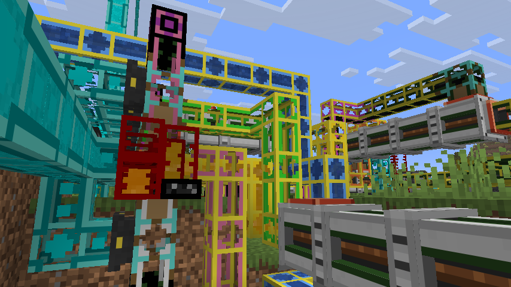
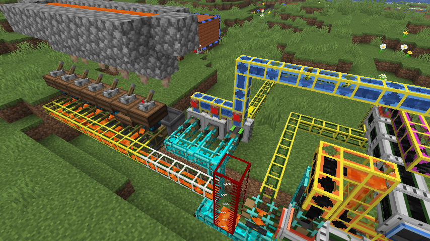
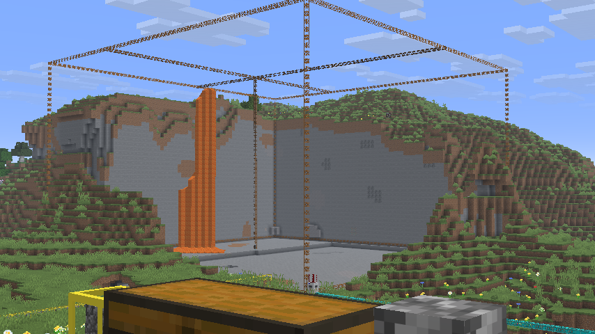
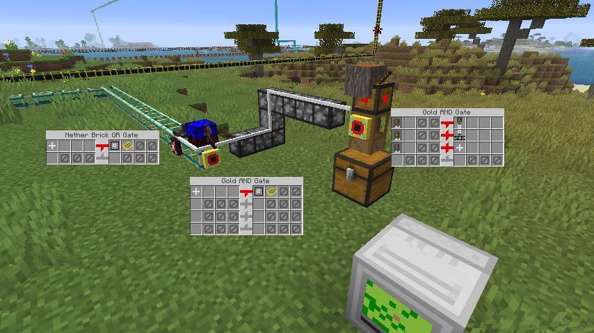
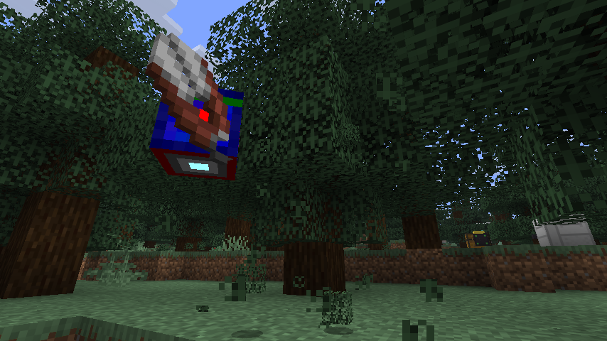

<!--
Template for Curseforge and Modrinth pages. In-game images excluded for now pending better screenshots
-->

**Summary field:**
BuildCraft 7.x & 8.x improved and unified on modern MC: pipes, engines, oil, quarries, builders, logic gates AND robots.

---

# BuildCraft Redux

Pipes, engines, oil, quarries, builders, logic gates and robots,
brought from BuildCraft 8.0.0 (1.12.2) and BuildCraft 7.1.27 (1.7.10)
and united in one mod for NeoForge.

In addition to porting all of the original recipes, original textures, and original mechanics,
systems have been improved (oil spawns, blueprints) and finished (help system, guide book).
Systems and mechanics left behind on 1.7.10 Minecraft that were dropped for 1.12.2 have been brought back wholesale, such as robots.

## Version support

|MC|NeoForge|Fabric|MC Forge|
|---|---|---|---|
| 1.21.1 | ✔ | ✔ | ✔ |
| 1.21.10 | ✔ | ✔ | ❌ |
| 1.21.11 | ✔ | ✔ | ✔ |
| 26.1.2 | ✔ | ✔ | ✔ |
| 26.2 | ✔ | ✔ | ✔ |
| 26.3 | ✔ | ✔ | ✔ |

---
# BuildCraft's systems

## Logistics and resource transportation

Item, fluid and energy pipes, starting with cobblestone, then specialty pipes, and make things compact with diamond pipes and logic gates.
Plug or paint them for separation, cover them with facades of any block to hide/organize, and wire them up with gates to replace redstone logic.

## Energy infrastructure

Redstone, Stirling and Combustion engines power factories with BuildCraft's Minecraft Joules (MJ). Find infinite oil springs in deserts and
oceans, pump it, refine it in the Distiller and Heat Exchanger, and burn the fuel. If you prefer utilizing universal Forge Energy,
build FE Engines to use FE for BuildCraft machines, convert MJ to FE with the Dynamo, or enable automatic conversion in the mod settings.

## Massive mines and building machines

Quarries carve out chunks of land down to the bedrock layer. Mark out a volume and let the Filler flatten, fill or shape it.
Scan a building with the Architect Table and the Builder rebuilds it anywhere, block for block,
down to every bit of data, including block inventories, states, and fluids.

## Logic networks

Logic Gates augment your existing pipes. When utilized correctly, you can make your factories smaller, more efficient, and unlock capabilities that you otherwise wouldn't have, such as robot control. Speaking of which...

## Robots are back!

The robotics system that was left on Minecraft 1.7.10 is back on all downloadable versions of the mod. You can again program robot boards, dock robots at stations on your pipes, and send
them to farm, harvest, haul items and fluids, or fight, entirely controlled by logic gates.

---
# New stuff
On top of existing systems, the following has been reworked or is completely new to the mod:
## Redux changes
- **Overworld oil spawns**: Infinite oil has been changed to not be their own biome, instead biomes tagged as "rich" (by default arid and deep ocean) now get distinctly wider and taller oil spouts.
- **Nether Oil**: Spouts of searing oil rarely present in the Nether. This should allow for Nether start challenge runs.
- **Wrench overhaul**: It's an actual tool now (in Minecraft terms), and now has a 3-tier progression path to expand capabilities (evolves the "Marker Connector" tool).
- **Enchantable machines**: You can now enchant the Miner and Quarry with applicable pickaxe enchants. This can be disabled/nullified in the config.
- **Machine augmentation**: You can place a Pump on top of a Miner or Quarry and have it drain fluids.
- Engines can now take heated fuels. These can either be beneficial or detrimental.
- The GUI "help" system (the purple "?" tab) is now implemented on all applicable screens.
- In-game Guide Book has been expanded and slightly re-worked. The [GitHub Wiki](https://github.com/legoj15/BuildCraft/wiki) is a mirror of these pages.
- Audio and visual effects (pipes utilize distinct sounds, searing fluids are steamy).
- Machines and pipes can be built in water without causing too many problems.
- Improved interaction with pipe addons like wires, plugs, and gates.
- The Filler block can now show an in-world preview of what it will fill. This used to be a creative-only feature.
- Builders show where they're stuck in the world, and have vastly improved handling of fluids.
- Machines that would otherwise destroy/void blocks now either collect them or eject them.
- Additional status indicators on blocks.
- Minor crafting recipe adjustments to items such as blueprints or blocks such as the builder and integration table.
- An absolute swath of things I considered bugs on 1.12.2 that are now fixed or improved.

## Built for today's servers

- **Respects land claims.** A large amount of effort went into making sure all automations respect mods and server plugins that claim land for multiplayer worlds. Blocks, pipes and robots without permissions cannot make changes to claimed land, even when using entities like TNT.
- **Performance.** Long pipe networks, idle machines, and pumps over huge lakes were tested thoroughly on servers and in singleplayer to make sure they do not introduce performance issues.
- **Recipe viewers.** Native support for JEI and REI.
- **In-game Guide Book** covering every block, item and gate, with robot tutorials. Pages also compatible with AE2's GuideME system.
- **Configurable.** MJ or RF/FE readouts, choose between 1.7.10 and 1.12.2 laser behavior, disable RF pipes or
  facades entirely for modpacks, or turn off new features.
- **Languages:** English, and with the help of contributors, Simplified Chinese and Russian.

## Q&A

**Is this a continuation of BuildCraft?**

I don't consider it one, this is a mod *based off of* BuildCraft 8.0.x and 7.1.x. It is *not* an official continuation. New features, tweaks, QoL improvements, and the entire porting process was managed by me (legoj15), and helped by people who [submitted feature requests and bug reports!](https://github.com/legoj15/BuildCraft/issues?q=is%3Aissue+state%3Aclosed+-author%3Alegoj15)

**Why choose *this* BuildCraft? There are 3 others!**

Honestly, I'm just one guy, and I made this the exact way I would have wanted BuildCraft to be beyond 1.12.2. I've added features and created assets unique to this project that hopefully others can enjoy.

**Can I use it in my modpack?**

Yes, absolutely.

**Compatibility?**

I have been making an effort to support other mods naturally, as I encounter problems, or as they are reported. If you come across a compatibility quirk, or have a request for better compatibility, please [create a GitHub issue.](https://github.com/legoj15/BuildCraft/issues/new/choose)

**Will updating from BuildCraft Unofficial break my world?**

For those of you that were using older versions, **no**, only the name changed. Blocks & items in world data, blueprints and config settings carry over. If you download mods
manually, look for and remove the old `BCunofficial-…jar` first. For users on *really old* BuildCraft Unofficial versions (the ones with the 8.0.0 names), systems are in place to attempt to upgrade your worlds gracefully. Those are considered alpha versions and I strongly recommend switching to whichever release version aligns with what you want from the mod.

**What's the future of BuildCraft Redux?**

All of my envisioned features have been added, and all additional work, such as ports to Fabric and classic Forge, have finished. Despite other offerings existing now (this was a barren space back on just 1.21.11), I intend to keep making this available for all current Minecraft versions, for as long as modloaders keep existing. If you would like something new, or for expanded support with another mod, please [request a feature.](https://github.com/legoj15/BuildCraft/issues/new/choose)

## Links

[Source code](https://github.com/legoj15/BuildCraft) · [Report a bug](https://github.com/legoj15/BuildCraft/issues/new/choose) · [Wiki](https://github.com/legoj15/BuildCraft/wiki)

Original BuildCraft by SpaceToad and the BuildCraft team. New and most 8.0.x ported mod code licensed under Mozilla Public License-2.0 (API is MIT);
older 7.99.x/8.0.x and 7.1.x ported code uses the Minecraft Mod Public License.
