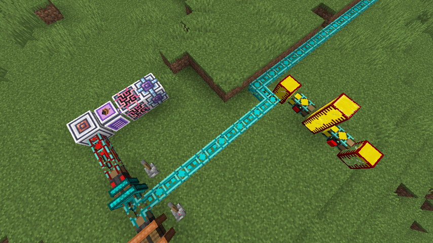
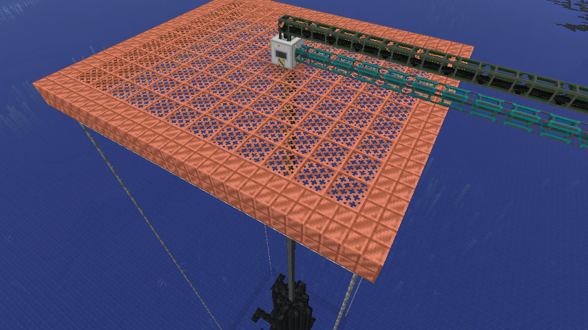
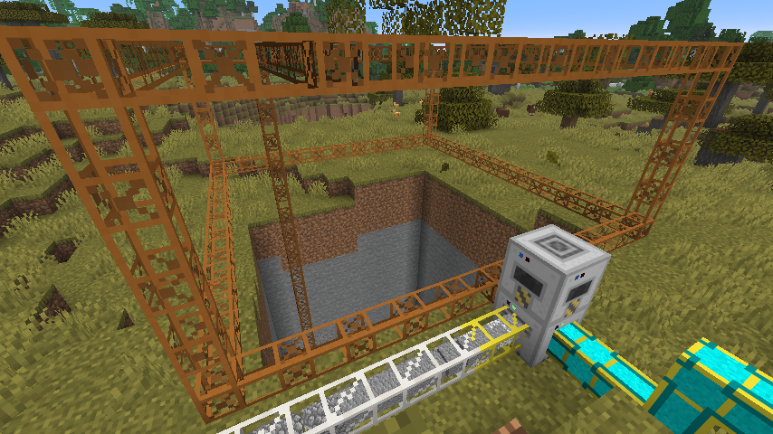
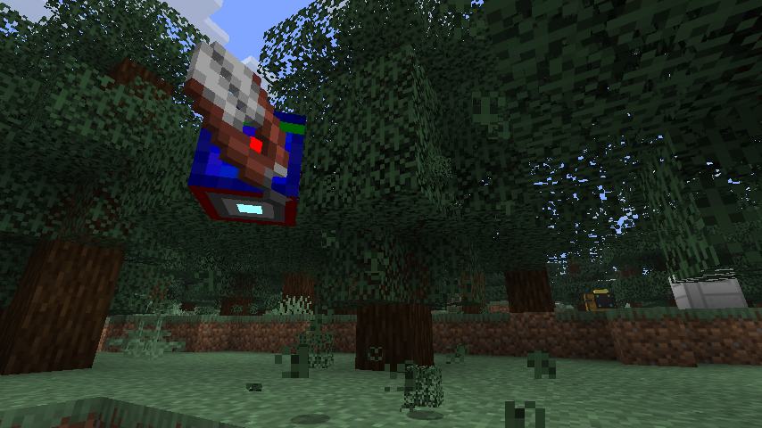

<!--
Draft store-page copy for Modrinth and CurseForge (one Markdown file for both; plan in docs/rebrand-redux.md).
Image paths are placeholders until the images are committed under docs/store/img/ and referenced by their
raw.githubusercontent.com URL. Summary line (both sites' short-description field) is the first block below.
-->

**Summary field:**
BuildCraft 7 and 8 reunited on modern NeoForge: pipes, engines, oil, quarries, builders, logic gates and robots.

---

# BuildCraft Redux

**The classic BuildCraft, rebuilt for modern Minecraft.** Pipes, engines, oil, quarries, builders,
logic gates and robots, brought back from BuildCraft 8 (1.12.2) and BuildCraft 7 (1.7.10) and
reunited in one mod for NeoForge.

Redux aims to play the way you remember: original recipes, original textures, original mechanics.
Where 1.12.2 had dropped something 1.7.10 did well (robots, above all), Redux brings it back.

| Minecraft | 1.21.1 | 1.21.10 | 1.21.11 | 26.1.2 | 26.2 | 26.3 |
|---|---|---|---|---|---|---|
| NeoForge | ✔ | ✔ | ✔ | ✔ | ✔ | ✔ |

---

## Move anything

Item, fluid and power pipes, from cheap cobblestone runs to sorting Diamond and Emerald pipes.
Paint them, seal them, cover them with facades of any block, and wire them up with gates.

## Power your base

Redstone, Stirling and Combustion engines drive everything with MJ. Find oil springs in deserts and
oceans, pump it, refine it in the Distiller and Heat Exchanger, and burn the fuel. Prefer Forge Energy?
FE pipes and engines plug straight into other tech mods.

## Dig and build

Quarries strip whole areas to bedrock. Mark out a volume and let the Filler flatten, fill or shape it.
Scan a building with the Architect Table and the Builder rebuilds it anywhere, block for block,
waterlogged blocks and all.

## Automate the logic

Gates watch your machines, tanks and inventories and switch pipes, engines and robots on conditions you
set. Lasers feed the Assembly, Integration and Programming Tables for advanced parts.

## Robots are back

Not seen since Minecraft 1.7.10: program robot boards, dock robots at stations on your pipes, and send
them to farm, harvest, haul items and fluids, or fight, all directed through gates. Robots were
checked behaviour-by-behaviour against the original 1.7.10 mod.

---

## Built for today's servers

- **Respects land claims.** Quarries, builders, pumps and robots act the same way a player does, so
  protection mods stay in force, and robots remember who deployed them.
- **Performance.** Long pipe networks, idle quarries and pumps over huge lakes no longer drag the
  server tick down.
- **Recipe viewers.** JEI on every version; REI on 1.21.x.
- **In-game Guide Book** covering every block, item and gate, with robot tutorials.
- **Configurable.** MJ or RF/FE readouts, the 1.7.10 or 1.12.2 laser behaviour, disable RF pipes or
  facades entirely for your modpack.
- **Languages:** English and Simplified Chinese. Translations welcome.

## FAQ

**Is this official BuildCraft?**
No. BuildCraft was created by SpaceToad and the BuildCraft team; Redux is an independent continuation
by legoj15. It was called *BuildCraft Unofficial* before version 2026.3.

**Is it the same as BuildCraft Community Edition?**
No. That is a separate project by a different team.

**Will updating from BuildCraft Unofficial break my world?**
No. Only the name changed; your world, machines, blueprints and config carry over. If you install mods
by hand, remove the old `BCunofficial-…jar` first.

**Can I use it in my modpack?**
Yes.

## Links

[Source code](https://github.com/legoj15/BuildCraft) · [Report a bug](https://github.com/legoj15/BuildCraft/issues) · [Wiki](https://github.com/legoj15/BuildCraft/wiki)

Original BuildCraft by SpaceToad and the BuildCraft team. Licensed MPL-2.0 (the API under MIT;
some original files under the Minecraft Mod Public License).
